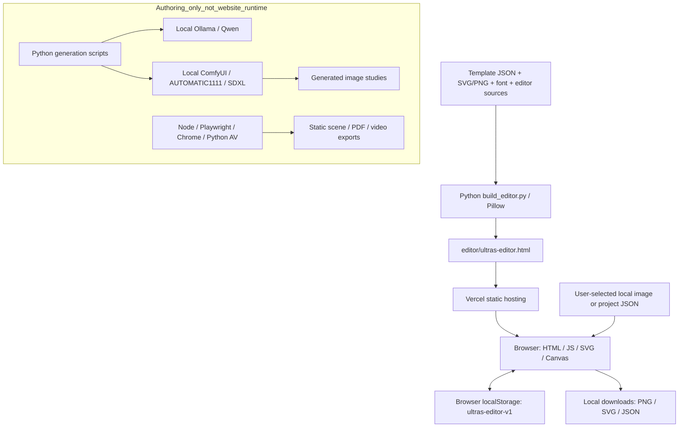

# Deployment handoff

Audit date: 2026-10-10. Audience: the person deploying this project and their AI agent. All application paths below are relative to the repository root. Run commands from that root unless explicitly stated otherwise. `<REPOSITORY_URL>` and `<DEPLOYMENT_URL>` are placeholders, not known account details. Local user-directory names are deliberately omitted; `%USERPROFILE%` identifies the original Windows account's home directory.

**Decision: deploy the existing editor as a static site on Vercel. No application server, database, AI service, or GPU is required. The first blocker is transfer: this Git repository has zero commits and zero tracked files. A clone alone currently contains none of the application.** Evidence: `editor/build_editor.py`, `editor/app.js`, `editor/editor-core.js`, and the Git audit in section 12.

This handoff describes the editor actually implemented in the repository. Local AI image-generation experiments and motion-export scripts are separate authoring tools, not features called by the editor. Their hosting requirements must not be silently added to this deployment.

## 1. System purpose and main user flows

The system is an Arabic, right-to-left visual-design editor for a predefined identity kit. It provides 13 templates, editable text and portrait fields, image positioning and scaling, a live SVG preview, browser-local draft saving, and downloadable PNG, SVG, and project JSON files. The distributable is one self-contained HTML file with embedded templates, images, font, CSS, and JavaScript. Evidence: `editor/build_editor.py:24`, `editor/template-fields.json`, `editor/app.js:3`, `editor/editor-shell.html`.

Main flows:

1. Open `/` or `/ultras-editor.html`, select a template, edit its exposed text fields, and inspect the preview (`editor/app.js`, `editor/template-fields.json`).
2. Select a local PNG/JPEG/WebP, resize/reposition it, or restore the original image. Processing happens in browser memory, not on a server (`editor/app.js:139`, `editor/app.js:191`).
3. Download PNG at original or doubled resolution, or SVG for further editing (`editor/editor-shell.html`, `editor/app.js:221`, `editor/editor-core.js:265`).
4. Save the selected design as project JSON and import it later; automatic drafts remain in the current browser and origin (`editor/app.js:57`, `editor/app.js:228`).
5. Separately, designers can use the static brand, scene, and motion files under `output/`. Those directories are not connected to an editor backend and are excluded from the default public deployment (`HANDOFF-AR.txt`, `scripts/export_motion_and_pdf.cjs`).

## 2. Architecture

| Part | Implementation and connection | Evidence |
|---|---|---|
| Frontend | Vanilla HTML/CSS/JavaScript, Arabic RTL, SVG editing, Canvas raster export; all bundled into one HTML file | `editor/editor-shell.html`, `editor/editor.css`, `editor/app.js`, `editor/editor-core.js` |
| Build-time packager | Python reads template metadata, SVG/PNG assets, source portrait dimensions, and Cairo font; embeds them into HTML | `editor/build_editor.py:24` |
| Backend / API | None in the editor. No API routes or server entry point identified | `editor/app.js`, `editor/editor-core.js`, `editor/build_editor.py` |
| Database | No SQL/NoSQL database; browser `localStorage` only | `editor/app.js:3`, `editor/app.js:57`, `editor/app.js:65` |
| Authentication | None; every visitor who can fetch the deployed HTML can use it | `editor/editor-shell.html`, `editor/app.js` |
| File storage | Bundled seed assets in HTML; uploaded images become data URLs in browser memory/localStorage; exports use browser downloads | `editor/build_editor.py`, `editor/app.js:139`, `editor/app.js:216` |
| Jobs / cron | No production jobs or schedule definitions found; authoring scripts run manually | `scripts/`, `output/preflight/`, `output/generation/` |
| Webhooks / WebSockets | None identified in frontend or authoring scripts; local AI scripts use HTTP requests/polling instead | `editor/app.js`, `editor/editor-core.js`, `output/generation/run_local_sdxl_comparison.py` |
| AI / LLM | No editor calls. Separate Python scripts call local Ollama/Qwen, ComfyUI, and AUTOMATIC1111 | `output/preflight/analyze_qwen_references.py:37`, `output/generation/run_local_sdxl_comparison.py:85`, `output/generation/run_local_sdxl_comparison.py:126` |
| Third-party APIs | No editor API dependency. Reference/source links are attribution links, not required remote assets | `assets/source/source-provenance.json`, `references/source-manifest.json`, `editor/build_editor.py` |
| Static host | Delivers the HTML and license; does not receive uploaded portraits or project JSON through application code | `editor/app.js:139`, `editor/app.js:216`, `editor/build_editor.py` |



The absence claims above are scoped to this repository's inspected source. Unrelated software or hidden scheduled tasks on the original PC are **unverified**.

## 3. Stack, versions, package manager, and lockfile

| Component | Confirmed version / requirement | Evidence |
|---|---|---|
| Frontend language | HTML5, CSS, modern JavaScript; no React/Next/Vue or bundler | `editor/editor-shell.html`, `editor/app.js`, `editor/editor-core.js` |
| Browser APIs | SVG DOM, Canvas, Blob URLs, `document.fonts`, `localStorage`, `Object.hasOwn` | `editor/app.js:28`, `editor/app.js:57`, `editor/editor-core.js:276` |
| Python | Locally tested CPython **3.12.14**, Windows x64 | Version command in section 4; `editor/build_editor.py` |
| Python dependency | **Pillow 12.3.0**, sole non-standard-library import of the editor packager | `editor/build_editor.py:9`; local import/version check |
| Python package manager | Locally available **pip 26.2.1**; no requirements file or Python lockfile in repository | `editor/build_editor.py:9`; manifest inventory |
| Node | Locally installed **v24.19.0**; authoring/testing only, not editor runtime | `scripts/export_motion_and_pdf.cjs`, `editor/tests/smoke.cjs`; version command |
| Playwright | Locally installed **1.62.1** in the Codex runtime, not a repo dependency | `editor/tests/smoke.cjs:5`; package version inspection |
| Chrome | System Google Chrome executable; exact installed browser version **unverified** | `editor/tests/smoke.cjs:37` |
| Font | Bundled Cairo variable font and OFL license; font release number **unverified** | `assets/fonts/Cairo.ttf`, `assets/fonts/OFL-Cairo.txt` |
| Other offline tooling | PyAV for an old motion encoder; exact working version **unverified** and unnecessary for deployment | `scripts/encode_motion.py:3` |
| Node package manager / lockfile | None declared. No `package.json`, `package-lock.json`, `yarn.lock`, or `pnpm-lock.yaml` found | Root/file inventory; Node scripts use absolute `require()` paths |
| Runtime version pin | No `.nvmrc`, `.node-version`, Python version pin, or deployment configuration supplied | Repository inventory |

The versions above describe the inspected PC, not promised host defaults. The recommended production path copies an already-built HTML file and needs no Python or application npm dependencies.

## 4. Run locally, install, build, and actual audit results

### Normal commands for the recipient

Use Python 3.12 and run these from the repository root. These are recipient commands; the audit did not create a virtual environment or rewrite outputs.

Windows PowerShell:

```powershell
py -3.12 -m venv .venv
.\.venv\Scripts\python.exe -m pip install Pillow==12.3.0
.\.venv\Scripts\python.exe -B editor/build_editor.py
.\.venv\Scripts\python.exe -B -m http.server 8769 --bind 127.0.0.1 --directory editor
```

Linux/macOS, with `python3.12` installed:

```sh
python3.12 -m venv .venv
.venv/bin/python -m pip install Pillow==12.3.0
.venv/bin/python -B editor/build_editor.py
.venv/bin/python -B -m http.server 8769 --bind 127.0.0.1 --directory editor
```

Open `http://127.0.0.1:8769/ultras-editor.html`. Stop the server with Ctrl+C. This is a local static file server, not an application backend. No dev/hot-reload script exists. Existing Windows launchers open the HTML directly without a server (`editor/افتح المحرر.cmd`, root `افتح محرر التصاميم.cmd`). There is no `npm install`, `npm run dev`, or `npm run build` script.

If using the prebuilt bundle unchanged, skip the environment/install/build commands and serve `editor/ultras-editor.html` directly. The full rebuild additionally requires the asset allowlist in section 12.

### Install actually executed in this audit

The exact executable was the original account's Codex Python, expressed without the account's personal directory name:

```powershell
$auditPython = Join-Path $env:USERPROFILE '.cache\codex-runtimes\codex-primary-runtime\dependencies\python\python.exe'
& $auditPython -B -m pip install --no-index --no-cache-dir --disable-pip-version-check Pillow==12.3.0
```

Result: **exit 0**. Output, with home/temporary paths redacted:

```text
Defaulting to user installation because normal site-packages is not writeable
Requirement already satisfied: Pillow==12.3.0 in <LOCAL_RUNTIME>/Lib/site-packages (12.3.0)
```

pip also reported failure to remove four temporary directories named `pip-build-tracker-*`, `pip-unpack-*`, `pip-ephem-wheel-cache-*`, and `pip-install-*` under its sandbox temporary directory. No dependency was installed or upgraded, and no project dependency files were created. This checks the available dependency; it is **not a clean-environment installation test**. A clean install and public package-index availability remain **unverified**.

### Production bundle build actually executed, preserving read-only code

An ordinary `python -B editor/build_editor.py` writes `editor/ultras-editor.html` and `editor/build-info.json` (`editor/build_editor.py:103`). Running it unmodified would violate the instruction to modify only this handoff. Instead, the complete existing `build()` was executed with only those two output writes intercepted in RAM. Reads, image processing, validation assertions, font embedding, and assembly all ran. Native Windows newline conversion was preserved, and both resulting byte arrays were compared with the existing files.

Exact verification command, after setting `$auditPython` above:

```powershell
@'
import runpy, hashlib, io
from pathlib import Path
from unittest.mock import patch
from types import SimpleNamespace
root = Path.cwd()
targets = {root/'editor/ultras-editor.html', root/'editor/build-info.json'}
saved = {}
original_stat = Path.stat
def capture(p, text, encoding=None, errors=None, newline=None):
    if p not in targets:
        raise RuntimeError('Unexpected write')
    b = io.BytesIO()
    f = io.TextIOWrapper(b, encoding=encoding or 'utf8', errors=errors, newline=newline)
    n = f.write(text)
    f.flush()
    saved[p] = b.getvalue()
    f.detach()
    return n
def vstat(p, *a, **kw):
    if p in saved:
        return SimpleNamespace(st_size=len(saved[p]))
    return original_stat(p, *a, **kw)
with patch.object(Path, 'write_text', capture), patch.object(Path, 'stat', vstat):
    runpy.run_path(str(root/'editor/build_editor.py'), run_name='__main__')
for p, b in saved.items():
    print(p.relative_to(root).as_posix(), 'bytes='+str(len(b)),
          'byte_identical='+str(b == p.read_bytes()),
          'sha256='+hashlib.sha256(b).hexdigest())
print('PASS: build executed with native newline handling; two output writes intercepted in RAM.')
'@ | & $auditPython -B -
```

Actual final output, exit 0:

```text
Built ultras-editor.html: 13 templates, 4,275,678 bytes
editor/ultras-editor.html bytes=4275678 byte_identical=True sha256=af3fa04294a1b04a2c2aa1d86f86f3caa2555fe103b666a04a29a16e8d07da80
editor/build-info.json bytes=114 byte_identical=True sha256=0d81cbb3a14802d2d16b8c7defc9e59a8916430c012b1cd6e02b3746570ee924
PASS: build executed with native newline handling; two output writes intercepted in RAM.
```

An earlier RAM capture encoded LF-only bytes and reported 4,274,940 bytes. Text comparison confirmed identical HTML after newline normalization. The final verification above corrected the interception to emulate real Windows writes; no source drift was found. Linux rebuilds can have different byte hashes because of line endings.

Additional actual checks: `node --check editor/app.js` and `node --check editor/editor-core.js` exited 0; all three inline scripts in `editor/ultras-editor.html` parsed successfully through Node's `vm.Script`. Existing reports show 14/14 smoke checks and 7/7 crop checks with zero recorded browser errors/network calls (`editor/tests/results/smoke-report.json`, `editor/tests/results/crop/crop-report.json`). These browser reports are **historical, not rerun in this audit**: their scripts write screenshots, downloads, and reports, prohibited by the current file-write constraint. Browser execution on Vercel is **unverified**.

The static staging command in section 11 has not been executed here because it creates `public/` files, also outside the allowed writes. Its input bundle was rebuilt and verified above. No remote deployment was attempted.

## 5. Environment variables

| Name | Purpose | Used at file:line | Required / optional | Example format |
|---|---|---|---|---|
| None — application defines no environment variables | Editor configuration is embedded at build time | `editor/build_editor.py:24`, `editor/app.js:3` | Not applicable | Not applicable |

No `process.env`, `os.environ`, `getenv()`, or dotenv loading was found in the inspected application and utility code. No `.env` or `.env.example` exists, and no `.env.example` was created because it would advertise nonexistent configuration. The local AI URLs are hardcoded constants, not environment variables (`output/preflight/analyze_qwen_references.py:37`, `output/generation/run_local_sdxl_comparison.py:85`).

`USERPROFILE` in this document's Windows commands is an OS-provided path helper, not an application setting. Do not add AI keys, database URLs, or other secrets to the HTML or Vercel environment for this editor. Hosting account authentication belongs to the deployer's tooling, not application configuration.

## 6. LOCAL-MACHINE AUDIT

### Runtime and data outside the repository

| Dependency / data | Location or evidence | Production disposition |
|---|---|---|
| Browser drafts and user images | Browser localStorage key `ultras-editor-v1`, scoped to the original origin/profile; `editor/app.js:3,57,65` | **Only user data needing migration for the editor.** Count/size and physical browser database path are **unverified**; not in Git. Export manually as below. |
| User-downloaded PNG/SVG/JSON | Browser-selected download locations; `editor/app.js:216` | Files outside the repo and total size **unverified**. Copy privately if the owner needs them; do not publish by default. |
| Codex Python/Pillow | `%USERPROFILE%\.cache\codex-runtimes\codex-primary-runtime\dependencies\python\python.exe` | Confirmed available; replace with normal Python/Pillow on another build machine. Not needed to serve prebuilt HTML. |
| Codex Node/Playwright | `%USERPROFILE%\.cache\codex-runtimes\codex-primary-runtime\dependencies\node\`; hardcoded in `scripts/render_assets.py:8`, `scripts/export_motion_and_pdf.cjs:5`, `editor/tests/smoke.cjs:5` | Required only to rerun the current authoring/test scripts as written. Their absolute paths are not portable. |
| System Chrome | `C:\Program Files\Google\Chrome\Application\chrome.exe`; `scripts/render_assets.py:10`, `editor/tests/smoke.cjs:37` | Offline rendering/test dependency only; no production browser executable needed. |
| Aider launcher | `%USERPROFILE%\Documents\Codex\Tools\Aider\bin\aider.cmd`, exists, 106 bytes | Development helper only. No frontend/build dependency on Aider; historical use noted in `HANDOFF-AR.txt`. |
| Ollama models/Qwen | `%USERPROFILE%\.ollama\models` exists; exact model installation/size **unverified**. Script requests `qwen3.8:27b-q4_K_M` | Authoring only; no model transfer for static hosting. `output/preflight/analyze_qwen_references.py:10,37`. |
| ComfyUI | `%USERPROFILE%\AI\ComfyUI` exists; installation version/total size **unverified** | Authoring only. `output/generation/run_local_sdxl_comparison.py:85`. |
| SDXL checkpoint | `%USERPROFILE%\AI\models\checkpoints\sd_xl_base_1.0.safetensors`, confirmed **6,938,078,334 bytes** | Not in repo, not needed online. `output/generation/run_local_sdxl_comparison.py:12,13,58`. |
| AUTOMATIC1111 | Local HTTP API expected; installation directory/version **unverified** | Authoring only. `output/generation/run_local_sdxl_comparison.py:126`. |
| PyAV / native FFmpeg libraries | `scripts/encode_motion.py:3` | Offline video encoding only; working import/build **unverified in this audit**. Do not include in static deployment. |
| SQLite/Postgres/MySQL/Mongo/Redis/Docker | No application configuration, connection code, DB files, schema, compose file, or Dockerfile found | Not required by inspected editor. Any unrelated PC installations are **unverified**. |
| Scheduled tasks / cron | No project scheduler definition found in `scripts/`, `editor/`, or generation utilities | OS-level task inventory **unverified**; no evidence the editor depends on scheduled work. |

Read-only connectivity probes found ports 8769, 11434, 8188, 7860, 5432, 3306, 27017, and 6379 unreachable from the audit environment. Sandbox/network isolation means this does **not** prove those services are absent or stopped on the PC. No model or service was started.

### Hardcoded loopback and Windows paths

| Location | Hardcoding and consequence |
|---|---|
| `output/preflight/analyze_qwen_references.py:37` | `http://127.0.0.1:11434/api/chat`; only works where Ollama is local |
| `output/generation/run_local_sdxl_comparison.py:85,126` | `http://127.0.0.1:8188` and `http://127.0.0.1:7860`; ComfyUI/A1111 authoring APIs |
| `output/generation/run_local_img2img.py:23,78,104` | Same local AI endpoints, including image upload |
| `output/generation/run_local_sdxl_comparison.py:12` | Original author's absolute Windows AI installation root; not portable |
| `scripts/render_assets.py:8,10` | Absolute Node and Chrome executable paths |
| `scripts/export_motion_and_pdf.cjs:5,9` | Absolute Playwright module and Chrome paths |
| `editor/tests/smoke.cjs:5,36,37`, `editor/tests/crop-smoke.cjs:5,16,17` | Absolute module, Chrome, and `%USERPROFILE%\AppData\Local\Temp\ultras-editor-downloads` paths |
| `editor/tests/download-debug.cjs:4,6,15` | Absolute download directory; test-only loopback server with dynamically assigned port |
| `editor/tests/preview.cjs:3,5`, `editor/palette-preview/render.cjs:1,4` | Absolute Playwright/Chrome paths |
| `tmp/motion-design-export/export.cjs`, `tmp/motion-design-export/encode-browser.cjs`, `tmp/render_social_kit.cjs` | Absolute local render dependencies; ancillary scripts, not deployed |
| `editor/افتح المحرر.cmd:2`, root `افتح محرر التصاميم.cmd:2` | Windows `start` command, but relative bundle path; not Linux entry points |

No hardcoded localhost dependency was identified in `editor/app.js` or `editor/editor-core.js`. Port 8769 is a local serving convention, not a required production port. SVG/XML namespace URLs are identifiers, not HTTP dependencies.

### Disk assets and transfer sizes

Measured file totals before this handoff; counts include generated artifacts and caches. All are currently untracked, not safely transferred by Git.

| Repository path | Files | Bytes | Treatment |
|---|---:|---:|---|
| `assets/` | 7 | 2,311,195 | Font, portrait, logo sources, provenance; keep in source transfer |
| `editor/` | 56 | 11,868,280 | Includes app, bundle, tests, comparisons, and results; deploy only allowlisted bundle/license |
| `output/` | 128 | 65,107,565 | Includes build inputs, generated media and AI studies; **do not globally discard this directory** |
| `references/` | 6 | 1,551,277 | Design references; not runtime dependencies |
| `scripts/` | 13 | 172,683 | Offline authoring scripts plus cache files; not runtime dependencies |
| `tmp/` | 374 | 33,846,282 | Render frames and scratch scripts; not needed for the editor |
| `editor/ultras-editor.html` | 1 | 4,275,678 | Production bundle, required |
| Editor rebuild asset allowlist | 29 | 16,198,650 | Font/license, portrait, and 26 template SVG/PNG files; section 12 |

There are no server DB rows or registered users to export in the implemented application (`editor/app.js`). Existing browser draft volume is **unverified**, not zero. To move drafts:

1. On the original PC, open the same browser profile and exact editor origin used for editing. `file://`, `http://127.0.0.1:8769`, `http://localhost:8769`, and a new HTTPS host do not share storage.
2. Select each template with wanted changes and click **حفظ ملف التحرير**. This exports the selected design only, including its embedded image and crop data (`editor/app.js:228`). Repeat for every wanted draft.
3. Transfer those JSON files privately. On the deployed editor use **فتح ملف تحرير** to import each. Do not commit user drafts, images, or exports to the public site.
4. For a size-only audit, the owner can run this in DevTools on the old origin without printing content:

```js
(() => {
  const raw = localStorage.getItem('ultras-editor-v1');
  return {utf8Bytes: raw ? new Blob([raw]).size : 0,
          draftCount: raw ? Object.keys(JSON.parse(raw).drafts || {}).length : 0};
})()
```

UTF-8 size is a transfer estimate, not a measurement of browser storage quota consumption. No author-browser storage was read during this audit.

## 7. External accounts and services

For the recommended deployment, obtain a Vercel account/team with project creation permission and access to the eventual Git repository. The remote repository URL, owner, billing plan, and authorized deployer are **unverified**. A custom domain is optional; DNS control is needed only if the author chooses one. No application API key, database host, transactional email, payment processor, object-upload service, or AI account is required by the inspected frontend (`editor/app.js`, `editor/editor-core.js`).

Vercel's static-hosting configuration is documented at [Configuring a Build](https://vercel.com/docs/builds/configure-a-build). Account eligibility, plan pricing, and deployment permissions were not tested. For AWS instead, obtain an AWS account/IAM permissions for S3 and CloudFront, plus DNS/ACM if using a custom domain; those are hosting resources, not application integrations.

## 8. Data, schema, migrations, and initialization

There is no production database to create and no migrations or seed command. A first load creates browser-local state from embedded template defaults (`editor/app.js:12,20`, `editor/build_editor.py:24`). The source seed definitions are `editor/template-fields.json` and the 13 template asset pairs under `output/identity/`.

The browser-state shape is:

```text
{ version: 1, selectedId, drafts: { [templateId]: { values, images, crop } } }
```

The downloadable/importable project shape is:

```text
{ format: "ultras-design", version: 1, templateId, values, images, crop }
```

Evidence: `editor/app.js:12,20,24,230`. `values` contains text fields, `images` contains validated raster data URLs, and `crop` contains zoom/offset/dimension metadata. Imports require version 1 and a recognized template. There is no multi-user sync or account linkage. Import limits include a 12 MiB JSON file, validated image formats, and text length constraints (`editor/app.js:24`, `editor/app.js:237`). Changing template IDs or the saved-data format requires an explicit migration design; none is implemented.

## 9. Static versus server requirements

**The production editor is pure static content.** `editor/build_editor.py` embeds CSS, three script blocks, font, SVGs, and thumbnails into `editor/ultras-editor.html`; `editor/app.js` reads files locally and downloads Blobs; `editor/editor-core.js` renders via browser Canvas. There are no serverless functions to deploy.

| Part requiring a process | Needed for production editor? | Proof |
|---|---|---|
| Static HTTP/HTTPS hosting | Yes, supplied by the chosen host | `editor/ultras-editor.html` |
| Python HTTP server | No; development convenience only | Section 4 command; existing launchers work without it |
| Python build process | No persistent server; optional pre-deployment build only | `editor/build_editor.py` |
| Ollama, ComfyUI, A1111 | No; needed only to rerun the optional AI-authoring experiments | `output/preflight/analyze_qwen_references.py:37`, `output/generation/run_local_sdxl_comparison.py:85,126` |
| Playwright/Chrome and video encoder | No; one-shot offline media generation | `scripts/export_motion_and_pdf.cjs`, `scripts/encode_motion.py` |

Putting the AI scripts on a static host will not turn them into callable APIs. Exposing them as online features would be a separate application project requiring API implementation, access control, storage, and GPU/runtime planning.

## 10. Hosting fit and recommendation

| Option | Works for current code? | What breaks / is not provided | Required setup |
|---|---|---|---|
| Vercel static project | **Yes; recommended** | Does not run the optional local GPU programs; does not provide user draft synchronization. Neither is an implemented editor feature. | Deploy only the staged bundle/license. Framework `Other`; exact settings in section 11. |
| AWS S3 + CloudFront, static only | **Yes** | No Python/Node jobs or AI services execute there; no user-data API. | Private S3 origin, CloudFront origin access control, default root `index.html`, HTTPS, content types, upload and cache invalidation process. |
| AWS architecture this code actually needs | **The same S3 + CloudFront static architecture** | No evidence justifies EC2, ECS, Lambda, RDS, or a GPU for the editor. Offline AI generation remains offline. | Same static setup above; do not provision a compute/database tier merely because Python scripts exist. |

**Can S3 alone host it? Yes, the editor's static files can run from an S3 website endpoint.** However, S3 website endpoints do not support HTTPS; use CloudFront for the recommended HTTPS website. S3 alone cannot execute the separate authoring scripts. See [AWS website endpoints](https://docs.aws.amazon.com/AmazonS3/latest/userguide/WebsiteEndpoints.html).

**Recommend Vercel** because the deployable artifact is one self-contained HTML file and Vercel needs fewer hosting components to configure than S3/CloudFront/IAM. This is a simplicity recommendation, not a measured cost comparison. Vercel supports serving static HTML/CSS/JS directly and custom output directories ([build configuration](https://vercel.com/docs/builds/configure-a-build)). Application evidence: `editor/build_editor.py`, `editor/build-info.json`.

## 11. Exact deployment checklist — Vercel

The following are instructions for the authorized deployer; this audit did not upload, commit, or deploy anything.

1. **Resolve transfer first.** Obtain a source commit or a reviewed file archive containing section 12's allowlist. The current original Git repository has no commit to clone. If a remote is later provided, run `git clone <REPOSITORY_URL>` and change directory to that checkout. The actual URL is **unverified**. Do not assume the original PC's files are available remotely.
2. Confirm `editor/ultras-editor.html` and `assets/fonts/OFL-Cairo.txt` exist. For the audited bundle, run:

   ```sh
   node -e "const fs=require('fs'),c=require('crypto');const b=fs.readFileSync('editor/ultras-editor.html');console.log(b.length,c.createHash('sha256').update(b).digest('hex'))"
   ```

   Expected: `4275678 af3fa04294a1b04a2c2aa1d86f86f3caa2555fe103b666a04a29a16e8d07da80`. If line endings were normalized during transfer, rebuild from source using section 4 and verify functionality; do not silently assume a content change is harmless.
3. Import the reviewed repository into Vercel. Set **Root Directory** to the repository root (not `editor`). Set **Framework Preset** to **Other**. No environment variables are needed.
4. Override **Install Command** with this exact no-dependency command:

   ```sh
   node -e "console.log('No application dependencies to install; deploying verified static bundle')"
   ```

5. Override **Build Command** with:

   ```sh
   node -e "const fs=require('fs');fs.mkdirSync('public',{recursive:true});fs.copyFileSync('editor/ultras-editor.html','public/index.html');fs.copyFileSync('editor/ultras-editor.html','public/ultras-editor.html');fs.copyFileSync('assets/fonts/OFL-Cairo.txt','public/OFL-Cairo.txt');console.log('Staged editor at / and /ultras-editor.html')"
   ```

   This is static release staging, not a source rebuild. It deliberately publishes only two copies of the standalone HTML plus the font license. Do not use `cp -r . public` or publish the entire `editor/` directory. The current checkout contains no `public/`; if the received checkout does, inspect it and ensure the final directory contains only the three intended files.
6. Set **Output Directory** to `public`. Leave development-command configuration unused. These settings avoid Python dependencies and hardcoded authoring paths during cloud deployment. No configuration file has been created by this audit.
7. Deploy a preview. Expected build log: `Staged editor at / and /ultras-editor.html`. Treat that output as **expected**, not a recorded cloud result. Inspect the static output list: `index.html`, `ultras-editor.html`, `OFL-Cairo.txt` only. Do not expose histories, test JSON, images from user drafts, model records, or the handoff itself.
8. On the preview URL, check both `/` and `/ultras-editor.html`. Check all 13 template selections, edit a text field, upload a non-sensitive test image, test 20%–300% zoom, download PNG at both resolutions and SVG, save JSON, reload, and import JSON. Confirm the export is legible in Arabic and the image is positioned correctly. These are acceptance checks for the deployer, not tests already performed online.
9. In browser DevTools, ensure editor actions make no AI/API/upload requests. Host infrastructure may add its own requests; distinguish those from `editor/app.js`. Verify no frontend exceptions. Use the stable final domain for draft storage; preview deployment origins have separate localStorage.
10. Promote the tested deployment to production in Vercel. If a custom domain is required, attach the author-approved domain in Vercel and apply the exact DNS records Vercel provides. Domain name and DNS records are **unverified**; do not invent them. Recheck HTTPS and exports on that final domain.
11. Migrate desired drafts using section 6. Record the deployment URL and source commit in the receiving team's release record. Retain the previous verified bundle/deployment for rollback; do not delete or overwrite original user drafts.

For future template edits, run the Python source build first and transfer the resulting `editor/ultras-editor.html`; the Vercel staging command does not detect stale source changes. `editor/build_editor.py` is the authoritative packager. Vercel configuration mechanism: [Configuring a Build](https://vercel.com/docs/builds/configure-a-build).

## 12. Code transfer and Git audit

Commands actually run: `git status --short --branch`, `git ls-files --stage`, `git log -1 --oneline`, `git status --ignored --short`, and `git check-ignore` against the bundle, asset, `.env`, `node_modules`, and a hypothetical SQLite filename.

Results:

```text
## No commits yet on master
?? .aider.chat.history.md
?? HANDOFF-AR.txt
?? assets/
?? editor/
?? output/
?? references/
?? scripts/
?? tmp/
?? [root Windows launcher]
```

`git ls-files --stage` returned no entries. `git log -1 --oneline` reported `fatal: your current branch 'master' does not have any commits yet`. The root Windows launcher is `افتح محرر التصاميم.cmd`. After this task, `DEPLOYMENT_HANDOFF.md` is also untracked. No commits, pushes, staging, or code modifications were performed.

**This is a Git repository, but nothing needed to build is committed.** No `.gitignore` exists; `.git/info/exclude` contains only template comments. The checked paths were not ignored. Thus secrets, `node_modules`, virtual environments, generated output, local databases, test artifacts, and histories are **not correctly excluded by project rules**. This task did not change ignore rules. Do not use `git add .` before reviewing the transfer.

Minimum prebuilt deployment transfer:

```text
editor/ultras-editor.html
assets/fonts/OFL-Cairo.txt
DEPLOYMENT_HANDOFF.md
```

For a maintainable source rebuild, include these additional files:

```text
editor/build_editor.py
editor/editor-shell.html
editor/editor.css
editor/editor-core.js
editor/app.js
editor/template-fields.json
editor/build-info.json
assets/fonts/Cairo.ttf
assets/source/mansour-abbas-2022-ronen-horesh.jpg
assets/source/source-provenance.json
assets/source/raam-logo-provenance.json
editor/المصادر والحقوق.txt
```

Also include **both `.svg` and `.png`** for every following basename under `output/identity/` (26 files total):

```text
01-introduction
02-quote
03-comparison
04-important-news
05-voting
06-story
07-speaker-lower-third
avatar
cover
logo-black
logo-primary
logo-symbol
logo-white
```

These are build inputs despite residing in `output/`: `editor/build_editor.py:29` reads the SVG and `editor/build_editor.py:42` reads its PNG thumbnail source. `editor/template-fields.json` also references the portrait's `defaultAsset`. Ignoring all `output/` without preserving these files will break rebuilds. There are no ignored-but-required files under current project ignore rules; all required files are simply untracked. Transfer permissions and final repository remote are **unverified**.

For original identity regeneration, additionally preserve `scripts/build_identity.py`, `scripts/identity_spec.json`, `assets/source/raam-logo-2021.svg`, and the other scripts/assets referenced by `scripts/render_assets.py`. That broader pipeline is not needed for the verified editor build and still has local absolute-path dependencies.

Keep `.aider.chat.history.md`, `tmp/`, `editor/tests/results/`, browser draft exports, and private working material out of the public web output. Review them before any source transfer; their personal content was not copied into this handoff. A future ignore policy should exclude `.env*` except `.env.example`, `node_modules/`, `.venv/`, `__pycache__/`, `*.pyc`, local DB files, and scratch/test results, while explicitly retaining the required template assets and distributable HTML. Creating that policy is outside this read-only task.

## 13. Risks and blockers

| Priority | Finding | Required response / evidence |
|---|---|---|
| Blocker | No commits, no tracked build inputs | Obtain a reviewed source transfer before expecting clone-based deployment; section 12 |
| Blocker if private access is required | No authentication or authorization | Ask author question 2 before making a supposedly private editor public. Do not claim a login exists; `editor/app.js`, `editor/editor-shell.html` |
| Transfer risk | No `.gitignore`; development history and test designs are untracked alongside sources | Transfer by allowlist, never publish the repo root; section 12 |
| Rebuild risk | No dependency lockfile; offline rendering/tests hardcode original PC paths | Use the verified prebuilt bundle for this deployment; editor source build only requires Pillow. `editor/build_editor.py`, `scripts/render_assets.py:8` |
| Build status | Editor build succeeded in RAM and matched existing bundle exactly; disk-writing/cloud staging build not executed due read-only constraints | Results and exact limitation in section 4; clean install/cloud execution **unverified** |
| Draft migration | New origin/browser has empty localStorage; clearing storage loses drafts | Export/import each desired JSON before moving; `editor/app.js:57,65,228` |
| Storage limits | Multiple embedded images can exceed localStorage quota; save catches errors but does not create a server backup | Use project JSON exports; `editor/app.js:55`, `editor/app.js:139` |
| CORS | Current embedded/local image path needs no cross-origin API configuration. Replacing embedded images with arbitrary remote URLs can taint Canvas and break PNG export | Preserve embedded assets; `editor/app.js:139`, `editor/editor-core.js:276` |
| Security headers | A strict CSP that blocks inline scripts/styles, data fonts/images, or Blob images can break this bundle | Test any host CSP against embedded scripts and export flow; `editor/build_editor.py`, `editor/editor-core.js:287` |
| Browser differences | Memory use for large/doubled Canvas exports, download handling, and font rendering vary | Test target desktop/mobile browsers; `editor/editor-core.js:276`, `editor/editor-shell.html` |
| Public assets | Every embedded template, seed text, image, and logo is downloadable by visitors | Author must approve publication and retained attribution; `editor/template-fields.json`, `assets/source/source-provenance.json`, `editor/المصادر والحقوق.txt` |
| Scope mismatch | Online AI generation, shared asset libraries, account management, and server video rendering do not exist in the editor | Do not promise them after static deployment; `output/generation/`, `output/preflight/`, `editor/app.js` |
| Stale deploys | Vercel staging copies the committed bundle, not editor source files | Rebuild bundle after source/template edits; `editor/build_editor.py`, section 11 |

Secrets audit: no committed secrets can exist in the current empty commit history. A heuristic scan covered 109 text/source files before this handoff and found no credential candidates after excluding embedded base64 assets. Initial matches were false positives within embedded binary asset text. This is **not an exhaustive security guarantee**; binary archives, unrelated PC credentials, full browser storage, and hidden external configuration were not audited. No secret values were printed or written, and no confirmed secret-bearing file was found.

No code was changed to address any risk. Previously recorded browser-test success does not prove production/mobile compatibility. No production account, DNS, or host-specific access control was verified.

## 14. Open questions only the author can answer

1. Is the public scope only the 13-template editor, or should selected motion/scene/social-profile downloads also be published? Default deployment includes only the editor and font license (`editor/build_editor.py`, `output/`).
2. Should anyone with the URL use the editor, or must access be restricted to named collaborators? Current code has no authentication (`editor/app.js`).
3. Which existing browser drafts and privately downloaded files must be preserved, and which original browser profile/origin contains them? Their sizes and contents are unverified (`editor/app.js:57,65`).
4. Are all embedded seed texts, portraits, attribution notices, and marks approved for publication, or must any template be removed/replaced first? (`editor/template-fields.json`, `assets/source/source-provenance.json`).
5. Which repository owner, Vercel team, authorized deployer, and final domain should own the release? No deploy target is configured in this repo.
6. Does “put the system online” include the separate Ollama/ComfyUI/A1111 authoring workflow? If yes, that is a separate GPU/API deployment scope, not supported by the current browser editor (`output/preflight/analyze_qwen_references.py`, `output/generation/run_local_sdxl_comparison.py`).

Open question count: **6**. These questions do not change the verified static architecture; questions 1, 2, 4, and 5 must be resolved before choosing the public audience and publishing content.
